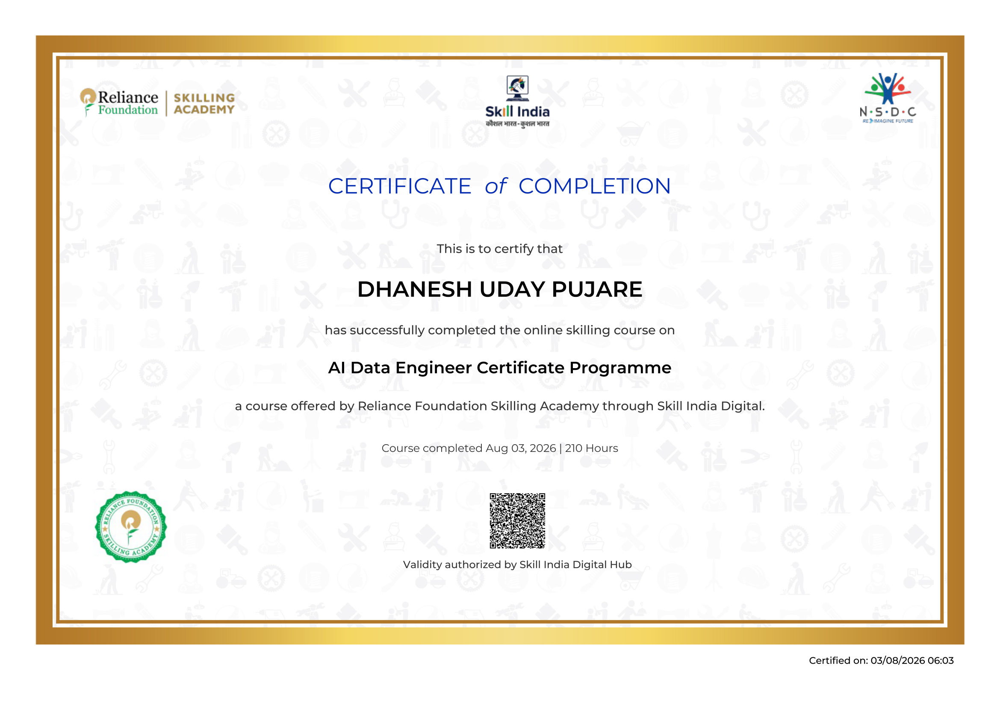
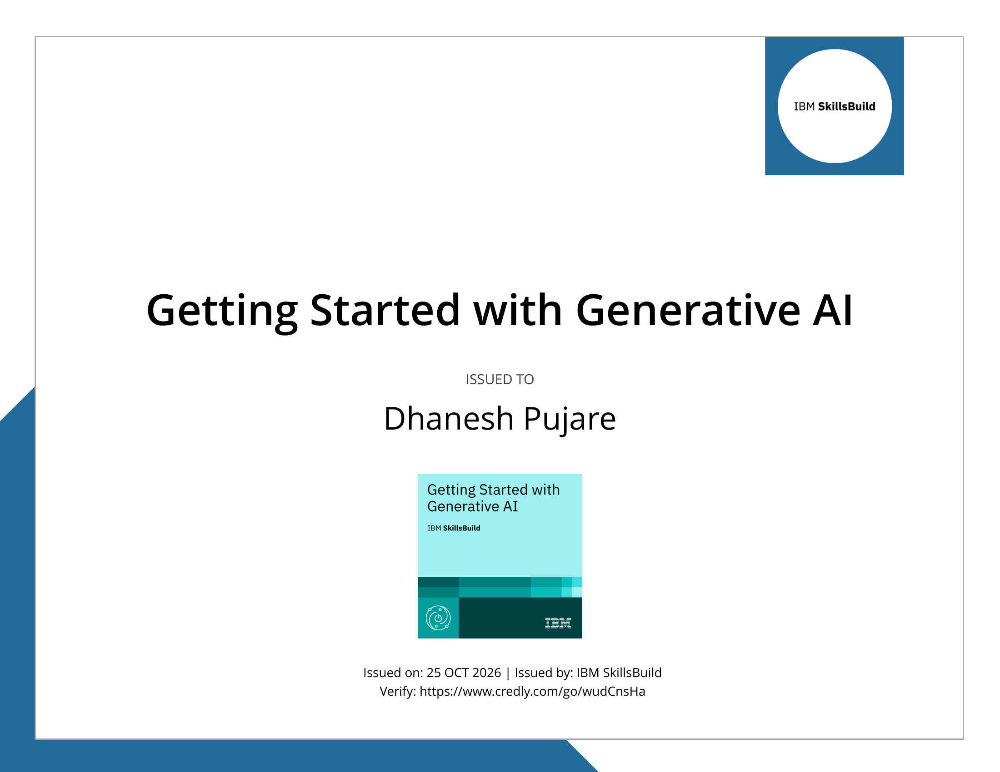
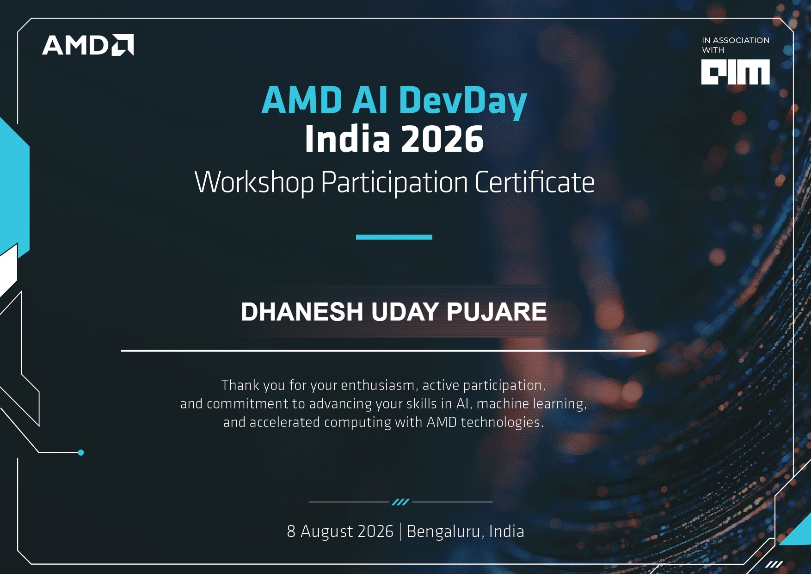
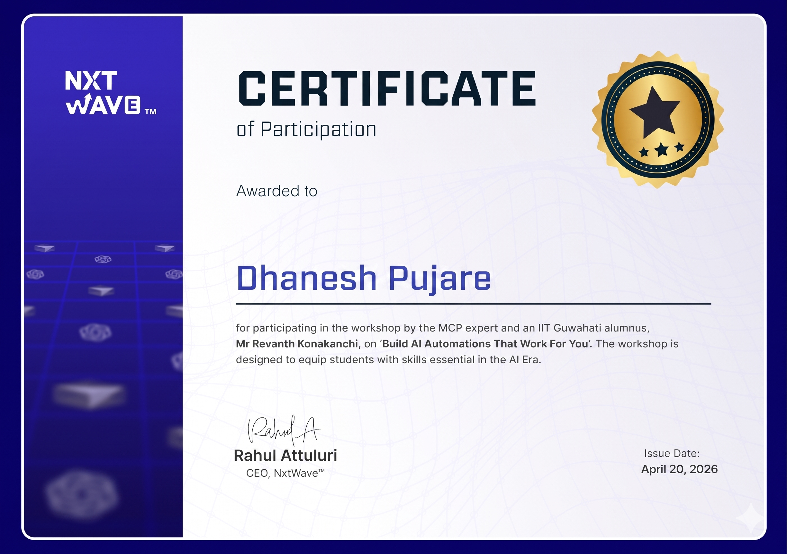
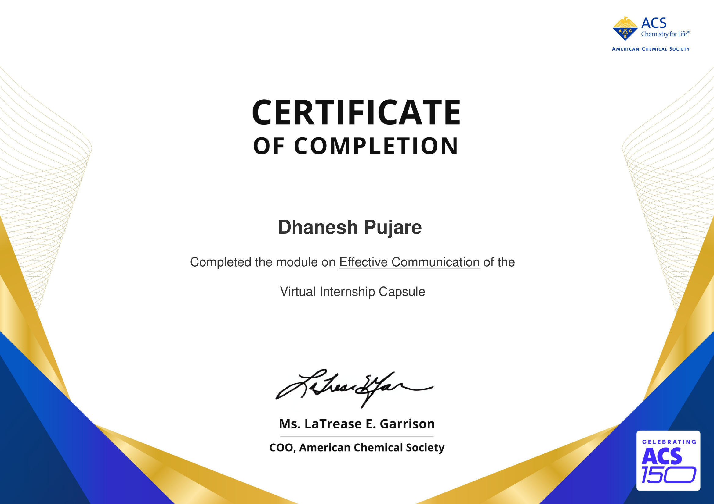

# 🎓 Professional Certifications & Credentials

<div align="center">


<br/>

**A curated, structured showcase of professional certifications, technical credentials, and specialized training earned by [Dhanesh Uday Pujare](https://github.com/DhaneshUdayPujare).**

[Explore AI & Data Engineering](#-1-artificial-intelligence-machine-learning--data-engineering) • [Explore Professional Development & ACS](#-2-professional-development--scientific-research-acs) • [Verification Summary Table](#-credential-verification-summary) • [Repository Structure](#-repository-structure)

</div>

---

## 📌 Overview

This repository serves as an official and verified repository for all certifications, specialized workshops, and credential badges. Each certificate includes high-resolution visual previews, metadata, verified credential links, and direct access to original PDF/image files.

---

## 📑 Table of Contents

- [🤖 1. Artificial Intelligence, Machine Learning & Data Engineering](#-1-artificial-intelligence-machine-learning--data-engineering)
  - [AI Data Engineer Certificate Programme (210 Hours)](#01-ai-data-engineer-certificate-programme-210-hours)
  - [Getting Started with Generative AI (IBM)](#02-getting-started-with-generative-ai)
  - [AMD AI DevDay India 2026 Workshop](#03-amd-ai-devday-india-2026-workshop)
  - [Build AI Automations That Work For You (NxtWave MCP)](#04-build-ai-automations-that-work-for-you-mcp-workshop)
- [📚 2. Professional Development & Scientific Research (ACS)](#-2-professional-development--scientific-research-acs)
  - [Crafting Impactful CVs and Resumes](#01-crafting-impactful-cvs-and-resumes)
  - [Effective Communication](#02-effective-communication)
  - [Fundamentals of Scientific Communication](#03-fundamentals-of-scientific-communication)
  - [Effective Strategies to Read a Paper](#04-effective-strategies-to-read-a-paper)
  - [Understanding IPs and Trademarks](#05-understanding-ips-and-trademarks)
- [📋 Credential Verification Summary](#-credential-verification-summary)
- [📂 Repository Structure](#-repository-structure)
- [📬 Connect & Contact](#-connect--contact)

---

## 🤖 1. Artificial Intelligence, Machine Learning & Data Engineering

### 01. AI Data Engineer Certificate Programme (210 Hours)

<div align="center">
  <a href="certificates/ai-and-data-engineering/01_AI_Data_Engineer_Reliance_Foundation.pdf">
    
  </a>
</div>

- **Issuing Organization:** Reliance Foundation Skilling Academy & Skill India Digital (NSDC)
- **Programme Title:** AI Data Engineer Certificate Programme
- **Duration / Intensity:** 210 Hours
- **Completed Date:** August 03, 2026
- **Certification Authority:** Skill India Digital Hub
- **Key Competencies:** Data Engineering Pipelines, Machine Learning Systems, Big Data Processing, Python for Data Science, Cloud Data Architectures.
- **Direct Links:** [📄 View Original PDF](certificates/ai-and-data-engineering/01_AI_Data_Engineer_Reliance_Foundation.pdf) | [🖼️ View High-Res Preview](previews/ai-and-data-engineering/01_AI_Data_Engineer_Reliance_Foundation.png)

---

### 02. Getting Started with Generative AI

<div align="center">
  <a href="certificates/ai-and-data-engineering/02_Getting_Started_with_Generative_AI_IBM.pdf">
    
  </a>
</div>

- **Issuing Organization:** IBM SkillsBuild
- **Badge / Credential Name:** Getting Started with Generative AI
- **Issue Date:** October 25, 2026
- **Credly Verification URL:** [https://www.credly.com/go/wudCnsHa](https://www.credly.com/go/wudCnsHa)
- **Key Competencies:** Generative AI Fundamentals, Large Language Models (LLMs), Prompt Engineering, Foundation Models, AI Ethics & Applications.
- **Direct Links:** [📄 View Original PDF](certificates/ai-and-data-engineering/02_Getting_Started_with_Generative_AI_IBM.pdf) | [🖼️ View High-Res Preview](previews/ai-and-data-engineering/02_Getting_Started_with_Generative_AI_IBM.png) | [🔗 Credly Verified Badge](https://www.credly.com/go/wudCnsHa)

---

### 03. AMD AI DevDay India 2026 Workshop

<div align="center">
  <a href="certificates/ai-and-data-engineering/03_AMD_AI_DevDay_India_2026.jpg">
    
  </a>
</div>

- **Issuing Organization:** AMD (Advanced Micro Devices)
- **Programme Title:** AMD AI DevDay India 2026 Workshop
- **Location:** Bengaluru, India
- **Date:** August 08, 2026
- **Focus Area:** AI, Machine Learning, and Accelerated Computing with AMD Technologies & ROCm Ecosystem.
- **Key Competencies:** Hardware Acceleration for Deep Learning, ROCm Open Ecosystem, High-Performance AI Inference and Model Fine-Tuning.
- **Direct Links:** [📄 View Full Resolution Image](certificates/ai-and-data-engineering/03_AMD_AI_DevDay_India_2026.jpg) | [🖼️ View Preview](previews/ai-and-data-engineering/03_AMD_AI_DevDay_India_2026.png)

---

### 04. Build AI Automations That Work For You (MCP Workshop)

<div align="center">
  <a href="certificates/ai-and-data-engineering/04_Build_AI_Automations_NxtWave.png">
    
  </a>
</div>

- **Issuing Organization:** NxtWave
- **Instructor / Lead:** Mr. Revanth Konakanchi (MCP Expert & IIT Guwahati Alumnus)
- **Executive Endorsement:** Rahul Attuluri (CEO, NxtWave)
- **Issue Date:** April 20, 2026
- **Focus Area:** Model Context Protocol (MCP), Autonomous AI Workflows, Agentic AI Systems.
- **Key Competencies:** Autonomous AI Agents, Tool Use & Tool Calling, Context Management, Automated Pipelines for Developer Workflows.
- **Direct Links:** [📄 View Full Resolution Image](certificates/ai-and-data-engineering/04_Build_AI_Automations_NxtWave.png) | [🖼️ View Preview](previews/ai-and-data-engineering/04_Build_AI_Automations_NxtWave.png)

---

## 📚 2. Professional Development & Scientific Research (ACS)

All modules in this section were completed as part of the **American Chemical Society (ACS Publications) Virtual Internship Capsule**, developing rigorous communication, research analysis, and intellectual property skills.

### 01. Crafting Impactful CVs and Resumes

<div align="center">
  <a href="certificates/professional-development-acs/01_Crafting_Impactful_CVs_and_Resumes_ACS.pdf">
    
  </a>
</div>

- **Issuing Organization:** American Chemical Society (ACS) - Virtual Internship Capsule
- **Module:** Crafting Impactful CVs and Resumes
- **Key Competencies:** Technical Portfolio Presentation, ATS Optimization, Impact-Driven Experience Framing.
- **Direct Links:** [📄 View Original PDF](certificates/professional-development-acs/01_Crafting_Impactful_CVs_and_Resumes_ACS.pdf) | [🖼️ View High-Res Preview](previews/professional-development-acs/01_Crafting_Impactful_CVs_and_Resumes_ACS.png)

---

### 02. Effective Communication

<div align="center">
  <a href="certificates/professional-development-acs/02_Effective_Communication_ACS.pdf">
    
  </a>
</div>

- **Issuing Organization:** American Chemical Society (ACS) - Virtual Internship Capsule
- **Module:** Effective Communication
- **Key Competencies:** Interpersonal Communication, Stakeholder Engagement, Professional Cross-Functional Collaboration.
- **Direct Links:** [📄 View Original PDF](certificates/professional-development-acs/02_Effective_Communication_ACS.pdf) | [🖼️ View High-Res Preview](previews/professional-development-acs/02_Effective_Communication_ACS.png)

---

### 03. Fundamentals of Scientific Communication

<div align="center">
  <a href="certificates/professional-development-acs/03_Fundamentals_of_Scientific_Communication_ACS.pdf">
    
  </a>
</div>

- **Issuing Organization:** American Chemical Society (ACS) - Virtual Internship Capsule
- **Module:** Fundamentals of Scientific Communication
- **Key Competencies:** Scientific Writing Standards, Data Visualization in Technical Reports, Peer Review Principles.
- **Direct Links:** [📄 View Original PDF](certificates/professional-development-acs/03_Fundamentals_of_Scientific_Communication_ACS.pdf) | [🖼️ View High-Res Preview](previews/professional-development-acs/03_Fundamentals_of_Scientific_Communication_ACS.png)

---

### 04. Effective Strategies to Read a Paper

<div align="center">
  <a href="certificates/professional-development-acs/04_Effective_Strategies_to_Read_a_Paper_ACS.pdf">
    
  </a>
</div>

- **Issuing Organization:** American Chemical Society (ACS) - Virtual Internship Capsule
- **Module:** Effective Strategies to Read a Paper
- **Key Competencies:** Research Synthesis, Critical Analysis of Methodologies, Literature Review Frameworks.
- **Direct Links:** [📄 View Original PDF](certificates/professional-development-acs/04_Effective_Strategies_to_Read_a_Paper_ACS.pdf) | [🖼️ View High-Res Preview](previews/professional-development-acs/04_Effective_Strategies_to_Read_a_Paper_ACS.png)

---

### 05. Understanding IPs and Trademarks

<div align="center">
  <a href="certificates/professional-development-acs/05_Understanding_IPs_and_Trademarks_ACS.pdf">
    
  </a>
</div>

- **Issuing Organization:** American Chemical Society (ACS) - Virtual Internship Capsule
- **Module:** Understanding IPs and Trademarks
- **Key Competencies:** Intellectual Property Protection, Patent Basics, Trademarks & Copyright Law for Tech and Research Innovations.
- **Direct Links:** [📄 View Original PDF](certificates/professional-development-acs/05_Understanding_IPs_and_Trademarks_ACS.pdf) | [🖼️ View High-Res Preview](previews/professional-development-acs/05_Understanding_IPs_and_Trademarks_ACS.png)

---

## 📋 Credential Verification Summary

| # | Credential / Certificate | Issuing Body | Domain / Category | Date | Verification / Access |
|---|--------------------------|--------------|-------------------|------|-----------------------|
| 1 | **AI Data Engineer (210 Hours)** | Reliance Foundation & Skill India | AI & Data Engineering | Aug 03, 2026 | [View PDF](certificates/ai-and-data-engineering/01_AI_Data_Engineer_Reliance_Foundation.pdf) |
| 2 | **Getting Started with Generative AI** | IBM SkillsBuild | Generative AI & LLMs | Oct 25, 2026 | [Credly Verified](https://www.credly.com/go/wudCnsHa) |
| 3 | **AMD AI DevDay India 2026** | AMD | Accelerated Computing & AI | Aug 08, 2026 | [View Image](certificates/ai-and-data-engineering/03_AMD_AI_DevDay_India_2026.jpg) |
| 4 | **Build AI Automations (MCP)** | NxtWave | Agentic AI & Automations | Apr 20, 2026 | [View Image](certificates/ai-and-data-engineering/04_Build_AI_Automations_NxtWave.png) |
| 5 | **Crafting Impactful CVs and Resumes** | American Chemical Society | Professional Development | 2026 | [View PDF](certificates/professional-development-acs/01_Crafting_Impactful_CVs_and_Resumes_ACS.pdf) |
| 6 | **Effective Communication** | American Chemical Society | Professional Development | 2026 | [View PDF](certificates/professional-development-acs/02_Effective_Communication_ACS.pdf) |
| 7 | **Fundamentals of Scientific Communication** | American Chemical Society | Scientific Research | 2026 | [View PDF](certificates/professional-development-acs/03_Fundamentals_of_Scientific_Communication_ACS.pdf) |
| 8 | **Effective Strategies to Read a Paper** | American Chemical Society | Scientific Research | 2026 | [View PDF](certificates/professional-development-acs/04_Effective_Strategies_to_Read_a_Paper_ACS.pdf) |
| 9 | **Understanding IPs and Trademarks** | American Chemical Society | Intellectual Property | 2026 | [View PDF](certificates/professional-development-acs/05_Understanding_IPs_and_Trademarks_ACS.pdf) |

---

## 📂 Repository Structure

```tree
Certifications/
├── README.md                                          # Interactive showcase & credential index
├── .gitignore                                         # Git ignore specifications
├── certificates/                                      # Original verified certificate files
│   ├── ai-and-data-engineering/
│   │   ├── 01_AI_Data_Engineer_Reliance_Foundation.pdf
│   │   ├── 02_Getting_Started_with_Generative_AI_IBM.pdf
│   │   ├── 03_AMD_AI_DevDay_India_2026.jpg
│   │   └── 04_Build_AI_Automations_NxtWave.png
│   └── professional-development-acs/
│       ├── 01_Crafting_Impactful_CVs_and_Resumes_ACS.pdf
│       ├── 02_Effective_Communication_ACS.pdf
│       ├── 03_Fundamentals_of_Scientific_Communication_ACS.pdf
│       ├── 04_Effective_Strategies_to_Read_a_Paper_ACS.pdf
│       └── 05_Understanding_IPs_and_Trademarks_ACS.pdf
└── previews/                                          # High-resolution web preview images (200 DPI)
    ├── ai-and-data-engineering/
    │   ├── 01_AI_Data_Engineer_Reliance_Foundation.png
    │   ├── 02_Getting_Started_with_Generative_AI_IBM.png
    │   ├── 03_AMD_AI_DevDay_India_2026.png
    │   └── 04_Build_AI_Automations_NxtWave.png
    └── professional-development-acs/
        ├── 01_Crafting_Impactful_CVs_and_Resumes_ACS.png
        ├── 02_Effective_Communication_ACS.png
        ├── 03_Fundamentals_of_Scientific_Communication_ACS.png
        ├── 04_Effective_Strategies_to_Read_a_Paper_ACS.png
        └── 05_Understanding_IPs_and_Trademarks_ACS.png
```

---

## 📬 Connect & Contact

- **Author:** Dhanesh Uday Pujare
- **GitHub Profile:** [@DhaneshUdayPujare](https://github.com/DhaneshUdayPujare)
- **Email:** [dhanesh18.pujarexb@gmail.com](mailto:dhanesh18.pujarexb@gmail.com)
